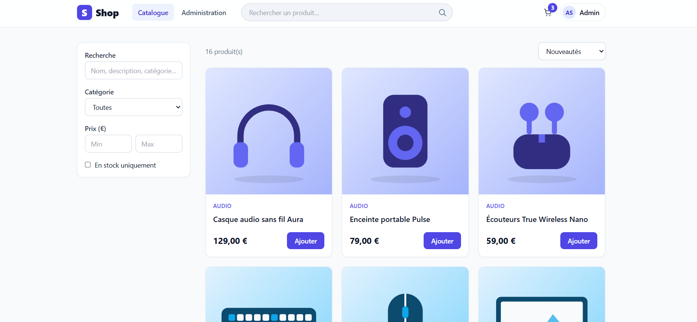
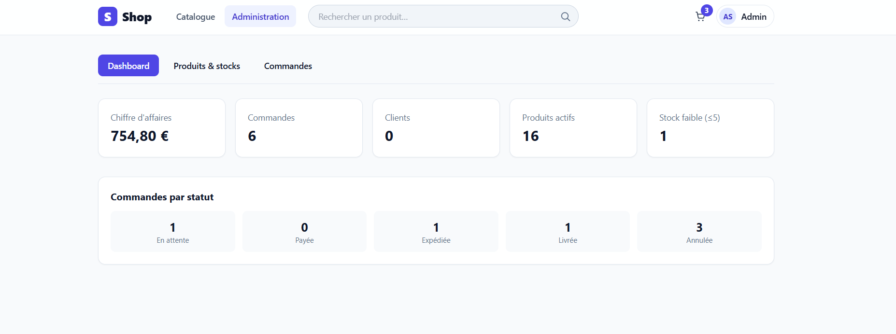
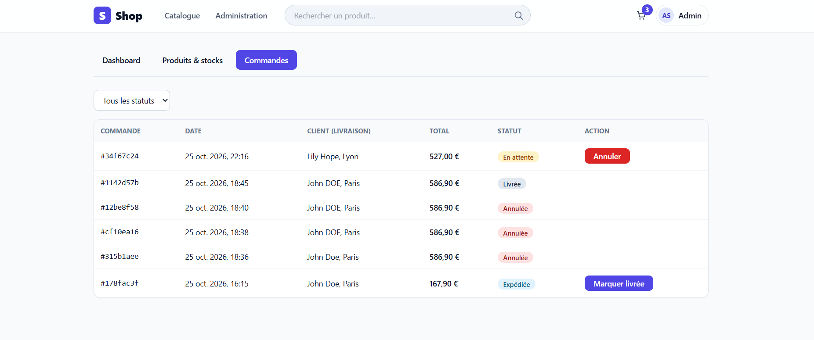
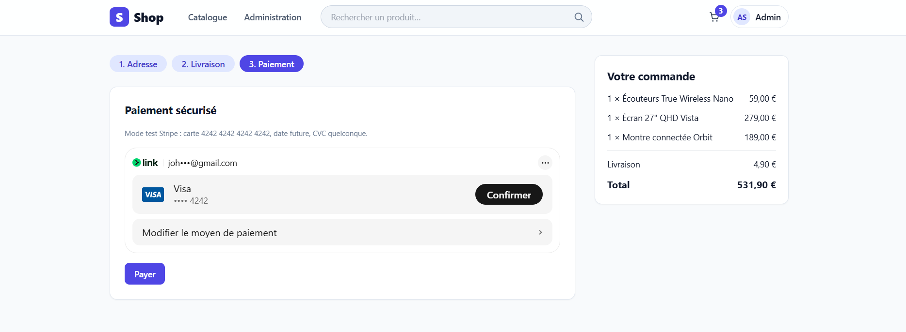

# Shop — Plateforme e-commerce (Spring Boot Clean Architecture + Next.js)

Plateforme e-commerce full-stack : catalogue avec recherche et filtres, panier, tunnel de commande en 3 étapes,
espace client et back-office administrateur. Le backend suit une **Clean Architecture (hexagonale)** stricte,
vérifiée automatiquement par des tests d'architecture.

**Démo en ligne** : https://shop-ecommerce-frontend-six.vercel.app/

**API à lancer au préalable** : `https://shop-ecommerce-backend.onrender.com/api/products`

> Le backend est hébergé sur l'offre gratuite de Render : après une période d'inactivité, la première requête peut
> prendre 30 à 60 secondes (réveil du serveur). Les suivantes sont instantanées.









## Comptes de démonstration

| Rôle | E-mail | Mot de passe |
|---|---|---|
| Administrateur | `admin@shop.com` | `Admin123!` |
| Client | créez-en un via *Inscription* | — |

Le paiement fonctionne en **mode test Stripe** : aucun argent réel n'est débité. Utilisez la carte
`4242 4242 4242 4242`, une date d'expiration future et n'importe quel CVC.

## Fonctionnalités

- **Authentification** : inscription (mots de passe hachés en BCrypt), connexion avec JWT, rôles `ROLE_CUSTOMER` et `ROLE_ADMIN`.
- **Catalogue** : pagination, tri (nouveautés, popularité, prix), filtres (catégorie, fourchette de prix, en stock),
  recherche multicritère sur nom, description et catégorie, page de détail produit.
- **Panier et commande** : panier persistant, tunnel en 3 étapes (adresse, livraison, paiement), réservation du stock,
  facture envoyée par e-mail (simulée dans les logs ou via MailDev).
- **Espace client** : historique des commandes, suivi du statut (En attente, Payée, Expédiée, Livrée), modification du profil.
- **Back-office** : tableau de bord (chiffre d'affaires, commandes, clients, stocks faibles), CRUD produits avec archivage,
  gestion des stocks, mise à jour des statuts de commande.

## Stack technique

| Couche | Technologies |
|---|---|
| Backend | Java 21, Spring Boot 3.4, Spring Security 6 (JWT, RBAC), Spring Data JPA / Hibernate |
| Base de données | PostgreSQL (Neon), migrations Flyway |
| Tests | JUnit 5, Mockito, AssertJ, ArchUnit, Testcontainers |
| Frontend | Next.js (App Router, TypeScript), Tailwind CSS, TanStack React Query, Zustand |
| Paiement | Stripe API (PaymentIntent, webhook signé, Stripe Elements) en mode test, ou passerelle simulée en local |
| DevOps | Docker, Docker Compose, Render (backend), Vercel (frontend) |

## Architecture backend

```
com.shop
├── domain            Cœur métier pur (aucune dépendance Spring/JPA)
│   ├── model         User, Product, Order, OrderStatus... (règles : stock, transitions de statut)
│   ├── repository    Ports de persistance (interfaces)
│   └── exception     Erreurs métier
├── application       Cas d'usage (orchestration) + ports sortants
│   ├── port          PasswordHasher, TokenIssuer, PaymentGateway, EmailSender
│   └── usecase       auth / catalog / order / admin
├── infrastructure    Adaptateurs (détails techniques)
│   ├── persistence   Entités JPA, Spring Data, adaptateurs de repository
│   ├── security      JWT, filtre, Spring Security 6, BCrypt, RBAC
│   ├── payment       StripePaymentGateway / FakePaymentGateway
│   ├── mail          SmtpEmailSender (MailDev) / LoggingEmailSender
│   └── config        Initialisation de l'administrateur
└── presentation      API REST : contrôleurs, DTO, gestion globale des erreurs
```

La règle de dépendance (`presentation → application → domain ← infrastructure`) est vérifiée par `ArchitectureTest`
(ArchUnit) : le domaine n'importe ni Spring, ni JPA, ni Stripe.

### Choix techniques notables

- **Stock fiable** : verrou pessimiste (`SELECT ... FOR UPDATE`, ordre déterministe) lors de la réservation au checkout,
  pour éviter la survente et les interblocages.
- **Commande validée seulement après paiement** : elle naît `PENDING` (stock réservé) et passe `PAID` quand le fournisseur
  confirme (webhook Stripe signé ou vérification côté serveur du PaymentIntent). L'opération est idempotente.
- **Annulation** d'une commande non payée : le stock est restitué.
- **Machine à états** des commandes dans le domaine : `PENDING → PAID → SHIPPED → DELIVERED` (+ `PENDING → CANCELLED`).
- **RBAC** : `/api/admin/**` réservé aux administrateurs ; un client ne peut lire que ses propres commandes.
- **Flyway** : schéma versionné (`V1`), catalogue de démonstration (`V2`), illustrations produits (`V3`) ; Hibernate en `ddl-auto=validate`.
- **Ports et adaptateurs** : changer de fournisseur de paiement ou d'envoi d'e-mails ne touche ni le domaine ni les cas d'usage.

## Lancer le projet en local

Prérequis : Java 21 ou plus, Maven, Node 20 ou plus, et une base PostgreSQL (Neon ou locale).

**Backend**

```bash
cd backend
cp .env.example .env      # renseignez DB_URL, DB_USER, DB_PASSWORD, JWT_SECRET
mvn spring-boot:run
```

`DB_URL` a le format `jdbc:postgresql://<hôte>/<base>?sslmode=require` ; l'utilisateur et le mot de passe vont dans
`DB_USER` et `DB_PASSWORD`. Flyway crée le schéma et les 16 produits de démonstration au premier démarrage.
Générez `JWT_SECRET` (32 caractères minimum) avec `openssl rand -base64 48`.

**Frontend**

```bash
cd frontend
cp .env.example .env.local
npm install
npm run dev
```

Boutique : http://localhost:3000 — API : http://localhost:8080

**Avec Docker** (PostgreSQL local et MailDev inclus) : `docker compose up --build`.
Avec Neon : `docker compose -f docker-compose.neon.yml --env-file .env up --build`.
Les e-mails de facture sont visibles dans MailDev sur http://localhost:1080.

## Tests

```bash
cd backend
mvn test      # tests unitaires (domaine, cas d'usage) + tests d'architecture
mvn verify    # ajoute les tests d'intégration *IT (Testcontainers, Docker requis)
```

## Paiement

- **En ligne** : Stripe en mode test (`PAYMENT_PROVIDER=stripe`), avec webhook signé sur `/api/payments/webhook`.
- **En local, par défaut** : passerelle simulée (`PAYMENT_PROVIDER=fake`), aucune clé requise.
- **Stripe en local** : mettre `PAYMENT_PROVIDER=stripe`, renseigner `STRIPE_SECRET_KEY` et `STRIPE_WEBHOOK_SECRET`
  côté backend, et `NEXT_PUBLIC_STRIPE_PUBLISHABLE_KEY` côté frontend. Carte de test : `4242 4242 4242 4242`.
  Webhook en local : `stripe listen --forward-to localhost:8080/api/payments/webhook`.

## Déploiement

- **Base** : [Neon](https://neon.tech) (PostgreSQL serverless).
- **Backend** : Render, *Web Service* en Docker (Root Directory `backend`), variables `DB_URL`, `DB_USER`, `DB_PASSWORD`,
  `JWT_SECRET`, `CORS_ALLOWED_ORIGINS`, `PAYMENT_PROVIDER=stripe`, `STRIPE_SECRET_KEY`, `STRIPE_WEBHOOK_SECRET`. Un fichier `render.yaml` équivalent est fourni.
- **Frontend** : Vercel (Root Directory `frontend`), variables `NEXT_PUBLIC_API_URL` (API Render) et `NEXT_PUBLIC_STRIPE_PUBLISHABLE_KEY`.

## API (extrait)

| Méthode | Route | Accès |
|---|---|---|
| POST | `/api/auth/register`, `/api/auth/login` | public |
| GET | `/api/products?q=&category=&sort=&minPriceCents=&maxPriceCents=&inStock=&page=&size=` | public |
| GET | `/api/products/{id}`, `/api/categories` | public |
| POST | `/api/orders` (checkout) | client |
| POST | `/api/orders/{id}/confirm-payment`, `/api/orders/{id}/cancel` | client |
| GET | `/api/orders`, `/api/orders/{id}` | client (ses commandes) |
| GET / PUT | `/api/users/me` | client |
| POST | `/api/payments/webhook` | Stripe (signature vérifiée) |
| GET / POST / PUT / PATCH / DELETE | `/api/admin/products...` | admin |
| GET / PATCH | `/api/admin/orders...`, `/api/admin/dashboard` | admin |

## Pistes d'amélioration

Paiement Stripe en mode réel, refresh tokens, upload d'images (S3/MinIO), recherche plein texte PostgreSQL
(`tsvector`), file de messages pour les e-mails, métriques Prometheus, intégration continue avec GitHub Actions.